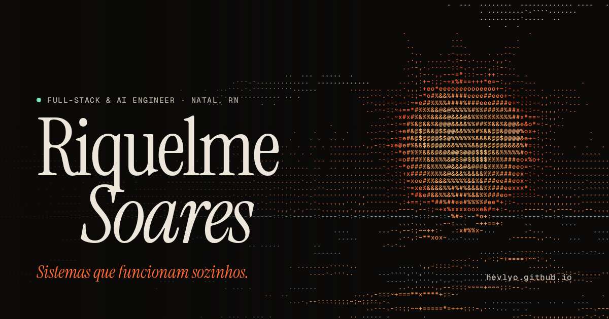

# hevlyo.github.io

Portfólio de **Riquelme Soares**, Full-Stack & AI Engineer em Natal, RN.
→ **[hevlyo.github.io](https://hevlyo.github.io)**



HTML, CSS e JavaScript escritos à mão, sem framework, etapa de build, dependências ou rastreadores.

## O que tem aqui

- **O céu de Natal, ao vivo.** O sol e a lua do topo estão onde estão agora sobre Natal (5°47′S, 35°12′W): altura, azimute, nascer, pôr, fase e até a inclinação do crescente vista daqui. O controle de hora e o timelapse percorrem o dia. Cálculos em [`assets/js/sky/astro.js`](assets/js/sky/astro.js), condensados das fórmulas do SunCalc.
- **Renderizador ASCII em WebGL.** Duas passadas: a cena vira uma textura com um texel por célula de caractere, e cada célula vira um glifo de um atlas ordenado pela densidade de tinta medida em tempo de execução. Ver [`renderer.js`](assets/js/sky/renderer.js).
- **Paleta ⌘K com BM25.** Busca por trechos do site com BM25 implementado do zero, mais comandos (tema, idioma, céu, imprimir como currículo).
- **Demos que rodam no navegador.** Uma porta de parte das regras do [ShellShield](https://github.com/hevlyo/ShellShield) com as mensagens reais do CLI, e uma simulação dos cenários do [ibx](https://github.com/hevlyo/ibx).
- **Telemetria do próprio site.** A seção "Este site" mede peso, requisições e FPS no navegador de quem visita, via Performance API.
- PT/EN, tema claro/escuro (com View Transition), `prefers-reduced-motion`, navegação por teclado e uma folha de impressão que transforma a página num currículo.

## Rodando localmente

Qualquer servidor estático serve. Por exemplo:

```sh
python3 -m http.server 4173
# abra http://localhost:4173
```

Os módulos ES precisam ser servidos por HTTP; abrir o `index.html` direto do disco não funciona.

## Estrutura

```
index.html            conteúdo em português (o inglês fica em assets/js/core/i18n.js)
404.html
assets/
  css/style.css       tokens, temas, layout e componentes
  fonts/              Instrument Serif, Geist e Geist Mono (subset latino, auto-hospedadas)
  img/                favicon, ícone iOS e imagem de compartilhamento
  js/
    main.js           inicialização
    core/             utilitários e i18n
    sky/              astronomia, renderizador WebGL e painel do céu
    ui/               tema, paleta, telemetria, mapa da stack, efeitos
    artifacts/        demos do ShellShield e do ibx (carregadas sob demanda)
```

O deploy é o GitHub Pages servindo a branch `main` a partir da raiz.
